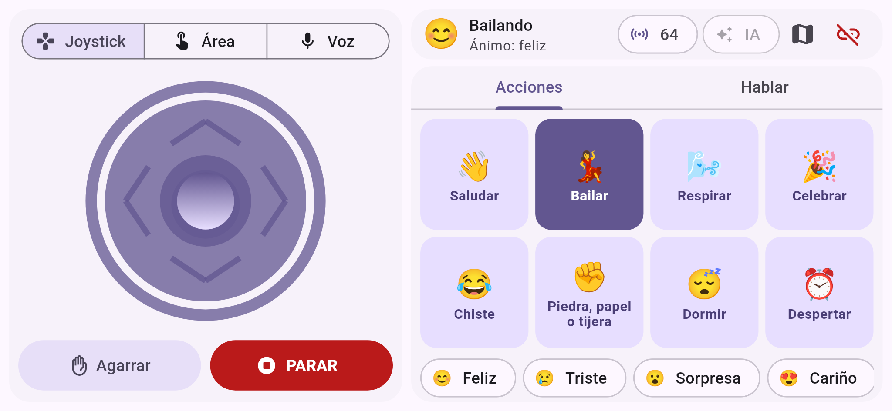
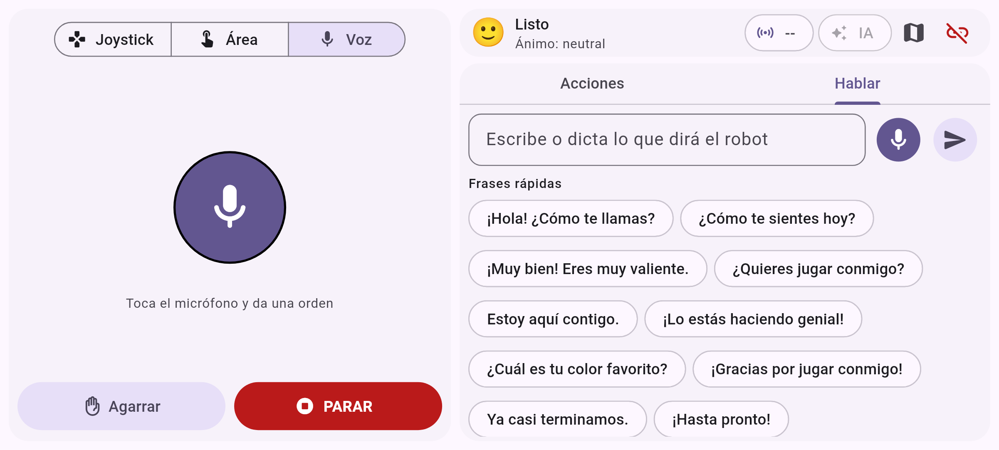

# Cambios de la app (rama `social`)

Este documento explica qué se cambió en la app, por qué, y cómo ejecutarla.

| Control por joystick y acciones sociales | Control por voz y "Hablar" |
|---|---|
|  |  |

## Resumen

| Antes | Ahora |
|---|---|
| El comando de voz no funcionaba | Funciona sin internet con un intérprete local; Gemini es opcional |
| Había que **mantener apretado** el botón; quedaba una animación de carga trabada | **Tocar para hablar**: anillo animado con el volumen, texto en vivo, se detiene solo al callar |
| No se veía qué entendió el robot | Muestra los pasos entendidos ("Adelante 20 cm", "Saludar") y si los entendió la IA o el intérprete local |
| Solo movimiento y garra | 8 acciones sociales, 6 emociones y frases rápidas |
| "Repetir" con mantener apretado | Pestaña **Hablar**: escribir o dictar lo que dirá el robot, más frases rápidas |
| Pantalla de control recargada con el mapa siempre visible | Distribución clara: movimiento a la izquierda, social a la derecha; el mapa abre en un diálogo |
| No se sabía qué hacía el robot | Barra de estado: emoción, acción actual y proximidad |
| Había que escribir la IP cada vez | Recuerda la última IP |
| Si el robot se apagaba, la app no se enteraba | Avisa "Se perdió la conexión" y vuelve a la pantalla inicial |

## Por qué no funcionaba la voz

1. El modelo `gemini-2.5-flash` ya no está disponible para claves nuevas (Google limitó el acceso a los modelos 2.5).
2. Si la app se compila sin `--dart-define=GOOGLE_API_KEY=...`, Gemini no tiene clave y todo comando fallaba con "El comando no se reconoció".
3. El plan gratuito de Gemini permite pocas peticiones por día.

**Solución:** se agregó un intérprete local en español (`lib/infrastructure/command_parser.dart`) que entiende las órdenes sin internet. Gemini queda como opción (chip **IA** en la barra superior) para frases más libres. Si Gemini falla o tarda más de 8 s, se usa el intérprete local automáticamente.

## Qué entiende el intérprete local

- Movimiento: "avanza", "adelante 30 centímetros", "avanza un metro y medio", "retrocede 2 segundos", "gira a la derecha", "gira 45 grados a la izquierda", "da una vuelta", "media vuelta".
- Garra: "agarra", "toma", "suelta", "deja".
- Parar: "para", "detente", "alto", "quieto".
- Social: "saluda", "hola", "baila", "respira", "celebra", "cuéntame un chiste", "juguemos piedra papel o tijera", "a dormir", "despierta".
- Emociones: "ponte feliz", "estás triste", "sorprendido", "tranquilo", etc.
- Decir algo: "di hola a todos", "saluda y di que hoy es un gran día".
- Secuencias con "y", "luego", "después" o comas: "avanza 20 centímetros, gira a la izquierda y luego agarra".
- Números con palabras: "treinta y cinco centímetros", "dos segundos".

Hay 35 pruebas automáticas en `test/command_parser_test.dart` (`flutter test`).

## Archivos nuevos o cambiados

| Archivo | Qué hace |
|---|---|
| `lib/infrastructure/command_parser.dart` | **Nuevo.** Intérprete de órdenes en español |
| `lib/infrastructure/voice_recognition.dart` | Reconocimiento "tocar para hablar", elige idioma español disponible, mensajes de error claros; Gemini + respaldo local |
| `lib/infrastructure/gemini.dart` | Modelo configurable, tiempo límite, temperatura baja |
| `lib/infrastructure/socket_connection.dart` | Buffer de mensajes, aviso de conexión perdida, `sendInstructions()` |
| `lib/presentation/control_page.dart` | Nueva pantalla de control |
| `lib/presentation/components/voice_panel.dart` | **Nuevo.** Botón de voz |
| `lib/presentation/components/social_panel.dart` | **Nuevo.** Acciones, emociones, hablar y frases rápidas |
| `lib/presentation/robot_state.dart` | **Nuevo.** Estado del robot (emoción, acción, proximidad) |
| `lib/presentation/connect_page.dart` | Pantalla de conexión renovada, recuerda la IP |
| `lib/presentation/components/map_widget.dart` | Se arregló una fuga de temporizadores y el mapa se puede abrir varias veces |
| `lib/main.dart` | Tema Material 3 (claro y oscuro) |

Se eliminaron los botones viejos que ya no se usan (`progressive_button`, `toggle_progressive_button`, `themed_*`, `sensor_widget`).

**No se cambió ninguna dependencia** (`pubspec.yaml` y `pubspec.lock` siguen igual), para no repetir los problemas de compatibilidad.

## Cómo ejecutar

### Sin Gemini (recomendado para la demo)
En Android Studio, conecta el teléfono y pulsa **Run**. La voz funciona con el intérprete local.

### Con Gemini (opcional)
1. Consigue una clave en [Google AI Studio](https://aistudio.google.com/apikey).
2. En Android Studio: **Run > Edit Configurations... > main.dart > Additional run args**:
   ```
   --dart-define=GOOGLE_API_KEY=TU_CLAVE --dart-define=GEMINI_MODEL=gemini-3.5-flash-lite
   ```
3. Ejecuta. En la pantalla de conexión aparecerá "Voz con IA: gemini-3.5-flash-lite" y el chip **IA** estará activo.

Desde terminal: `flutter run --dart-define=GOOGLE_API_KEY=TU_CLAVE`.

### Conexión con el robot
1. Activa el punto de acceso por Bluetooth del teléfono.
2. Conecta el robot al teléfono (Wireless and Networks > Bluetooth).
3. Ejecuta `main.py` en el robot. La pantalla mostrará la IP.
4. Escribe la IP en la app y pulsa **Conectar**.

## Uso de la pantalla de control

- **Izquierda:** selector Joystick / Área / Voz, el control elegido, botón de garra y botón rojo **PARAR** (detiene cualquier cosa).
- **Barra superior derecha:** cara y acción actual del robot, proximidad (se pone roja si hay algo muy cerca), chip **IA**, mapa y desconectar.
- **Acciones:** toca una tarjeta y el robot la ejecuta; la tarjeta queda resaltada mientras dura. Abajo, las emociones cambian la cara del robot.
- **Hablar:** escribe una frase y envíala, o toca el micrófono para que el robot repita lo que dices. Las frases rápidas sirven para guiar la interacción sin escribir.
